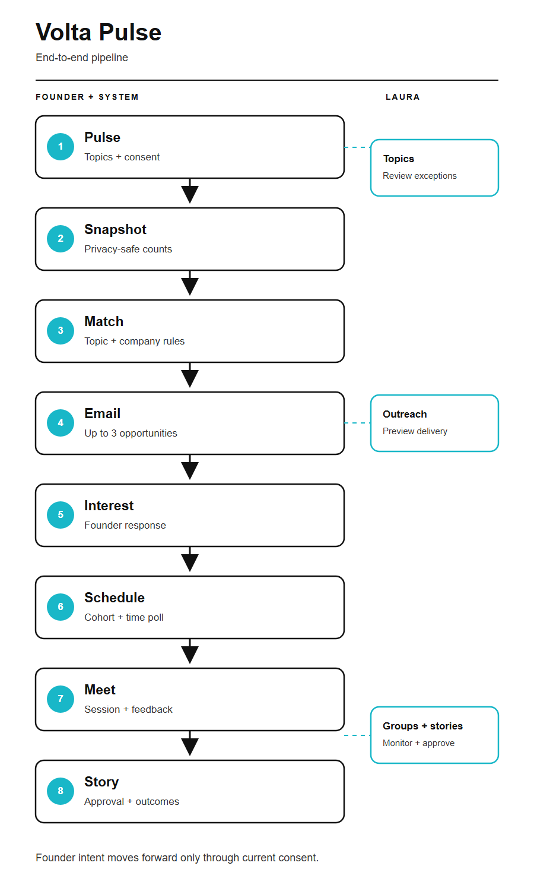

# Volta Pulse

A founder community application for sharing current challenges and experience, finding relevant peers, coordinating small-group conversations, and reviewing community stories. This repository contains a working fictional V1 demo and a gated Google Apps Script implementation.


## Features

- Founder topic capture in the founder's own wording, with autocomplete, a deterministic demo classifier, and a staff queue for ambiguous or new topics.
- Consent-aware, exact-topic matching with expiry, cooldowns, digest limits, and company-level participation rules.
- A monthly snapshot with frozen exact counts, personal/current-experience cards, chart filters, and one-click contributions.
- Small-group scheduling with explicit interest, availability, identity-sharing consent, and a minimum of three distinct companies.
- Feedback with one explicit sharing choice and story drafts that Laura can review, edit, approve, regenerate, or discard.
- Staff controls for fixture profiles, simulated delivery/booking, draft previews, and outcomes.

Private monthly reviews are never imported. A live AI provider is not configured; the included classifier and story generator are deterministic demo implementations.

## Technology

TypeScript, a Node.js local server, Vite for the web build, esbuild for Apps Script packaging, Vitest for automated checks, and Playwright for browser tests. The Google implementation uses Apps Script V8 with Sheets, Gmail, and Calendar adapters.

## Run locally

Requires Node 22.12+ (validated with Node 24).

From the cloned repository directory, run on Windows, macOS, or Linux:

```sh
npm ci
npm run dev
```

Keep that terminal running and open <http://127.0.0.1:5173>. Use `Ctrl+C` to stop the foreground server. No Google credentials or environment file are required for the fictional demo.

On Windows, you can start the demo in the background instead:

```powershell
npm.cmd ci
npm.cmd run demo:start
```

Open <http://127.0.0.1:5173>. Expand **Fictional demo sign-in accounts**. Use a founder to capture topics or Laura to preview matching, simulate delivery/booking, choose a fixture profile, and inspect outcomes. Credentials are intentionally public fictional test values fetched from the local server; they are excluded from deployed/browser bundles. Authentication stays in memory, so refreshing requires sign-in.

On Windows, `demo:start` launches a hidden background server, checks readiness, and reuses an already running demo. Logs and the process ID are saved in `.pulse-local`. Run it again if the server stops or after restarting your computer. For foreground development, use `npm.cmd run dev` and keep that terminal running.

You can also double-click `Start Volta Pulse.cmd` in the project folder. Windows reboot or sign-out stops the local server; it does not automatically start with Windows. The launcher starts it again without installing a service or changing Windows startup settings.

The server binds to loopback. It starts with the BASE profile at `2026-10-13T12:00:00Z`, pre-generates draft opportunities, and uses fake transports. State is held in the server process; restart or staff reset restores a clean fixture. Advancing the demo clock exercises expiry and follow-up. No real Gmail or Calendar calls are made.

## Verify and package

For full verification on a new machine:

```sh
npx playwright install chromium
npm run verify
```

| Command | Purpose |
|---|---|
| `npm run check` | TypeScript, fixture schemas/provenance, and source boundaries |
| `npm test` | Unit, integration, and acceptance tests |
| `npm run test:e2e` | Chromium browser tests |
| `npm run build` | Web assets and the Google Apps Script package |
| `npm run release:check` | Deployment artifact boundaries and current activation gates |
| `npm run verify` | Checks, builds, all tests, acceptance report, and release checks |
| `npm run fixtures:validate` | Validate the immutable source and derived fixtures |
| `npm run fixtures:import` | Rebuild fixtures; requires Python with `openpyxl` |
| `npm run hooks:install` | Enable this repository's pre-commit checks |

On Windows PowerShell, use `npm.cmd` if execution policy blocks `npm.ps1`. `hooks:install` affects this repository only and makes pre-commit run the fast checks. Hooks never deploy or rewrite source.

The original workbook scenarios remain marked NOT_RUN in the immutable source; observed application results are recorded separately in `reports/acceptance-results.json`. See [verification evidence](reports/verification.md) for the scope and dates of prior checks.

`dist/web` is the browser package. `dist/apps-script` contains `Code.gs`, self-contained `Index.html`, and the Google manifest. It contains no demo authentication, credential fixtures, founder seed data, or oracle outputs. Build outputs, dependencies, runtime logs, local environment files, and authenticated clasp configuration are excluded from Git. Deployment and OAuth authorization are separate owner actions.

## Project structure

- `src/ai`: structured topic-classification and story-drafting contracts plus the deterministic DEMO provider. A live model/provider is not configured.
- `src/domain`: consent, expiry, exact-topic matching, novelty, exact-count snapshot, group quorum and story rules.
- `src/auth` and `src/service`: verified sessions, founder ownership, explicit submissions, staff authorization and request idempotency.
- `src/adapters` and `src/jobs`: memory/Sheet persistence, fake/Google transports, durable outbox and scheduled workflows.
- `src/ui`, `src/styles`, `src/email`: founder/staff interfaces and escaped HTML/plain-text email templates.
- `fixtures`: immutable synthetic source, typed derived data, profiles and reference expectations. Operational imports exclude demo credentials/oracles/test instructions.
- `tests`, `reports`, `docs`: checks, observed evidence and operational handover.

See [deployment](docs/deployment.md), [Laura's runbook](docs/laura-runbook.md), [technical recovery](docs/recovery.md), [live gates](docs/live-gates.json), and [fixture provenance](fixtures/fixture-manifest.json).

## Architecture and workflow

The local server and Apps Script backend share the domain and service layers. Adapters provide persistence, authentication, and delivery; the local demo substitutes in-memory storage and fake transports. Durable outbox jobs handle matching, delivery, booking, housekeeping, and monitoring.



See the [full workflow diagram](docs/volta-pulse-end-to-end.svg) and [architecture decisions](docs/volta-pulse-architecture-decisions.svg) for more detail.


Current launch state is **DEMO / DRAFT_ONLY**. Google adapter source and contract tests are not evidence of a live deployment. Real credentials, resources, ownership, policies, integrations, support and activation remain gated.
